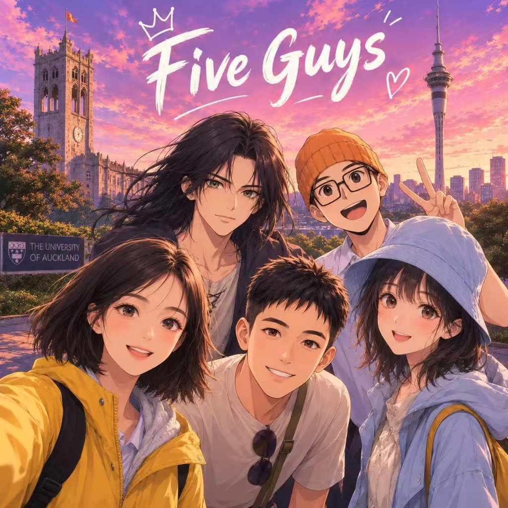

# CS734 project - Team Five Guys

Welcome to the project for COMPSCI 734 - Mobile, Web & Enterprise Computing. We look forward to seeing the amazing things you create this semester! This is your team's repository.

Your team members are:
- Xinru Cui (xcui573)
- Yixuan Sun (ysun801)
- Rui Wang (rwan911)
- Sam Yao (byao937)
- Jenny Yin (jyin852)

You have complete control over how you run this repo. All your members will have admin access. The only thing setup by default is branch protections on `main`, requiring a PR with at least one code reviewer to modify `main` rather than direct pushes.

Please use good version control practices, such as feature branching, both to make it easier for markers to see your group's history and to lower the chances of you tripping over each other during development

