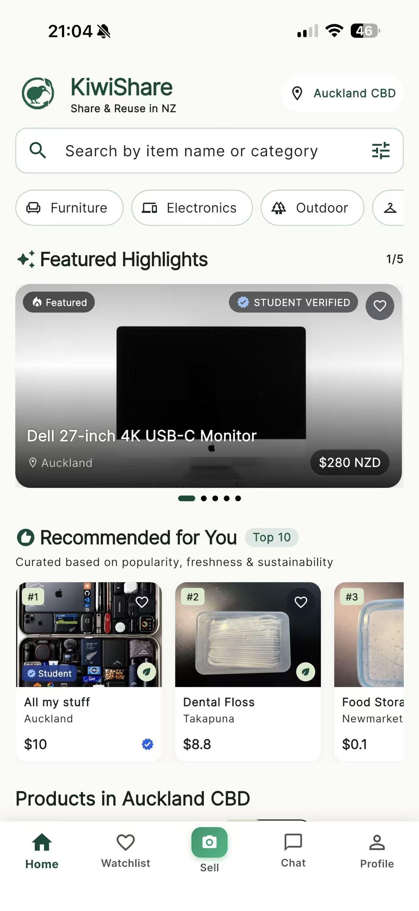
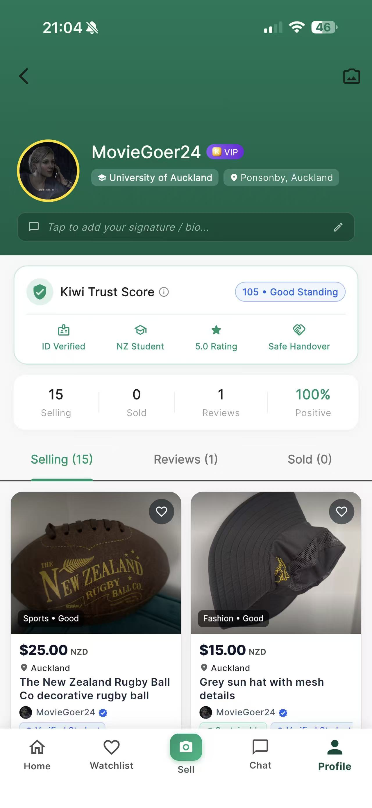
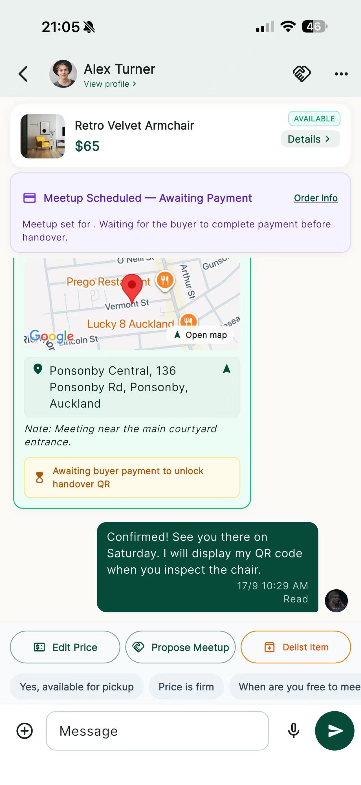
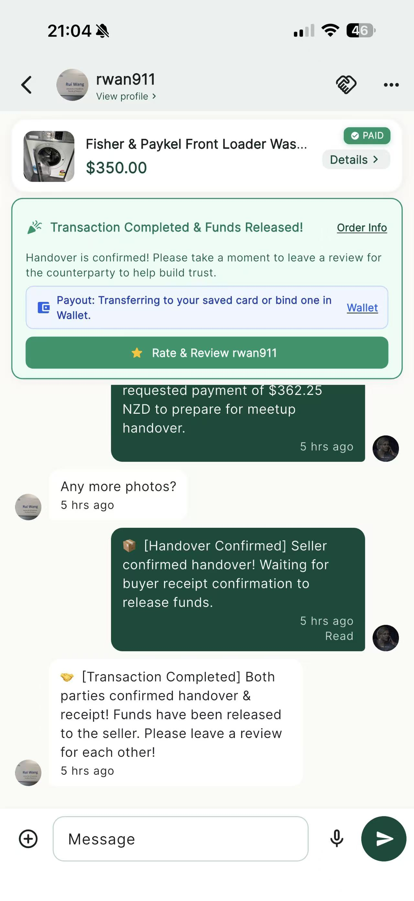

<p align="center">
  
</p>

<h1 align="center">KiwiShare</h1>

<p align="center">
  <strong>Share &amp; Reuse in New Zealand</strong><br />
  A cross-platform second-hand marketplace built for COMPSCI 734.
</p>

<p align="center">
  <strong>Team Five Guys · COMPSCI 734 · University of Auckland</strong>
</p>

<p align="center">
  <a href="https://kiwishare.online">Website</a> ·
  <a href="docs/demo-guide.md">Demo Guide</a> ·
  <a href="docs/architecture.md">Architecture</a> ·
  <a href="docs/security-owasp.md">Security</a> ·
  <a href="https://github.com/UOA-CS734-S2-2026/project-implementation-five-guys/releases">Releases</a> ·
  <a href="https://github.com/UOA-CS734-S2-2026/project-implementation-five-guys/wiki">Wiki</a>
</p>

<p align="center">
  
  
  
  
</p>

The project is organised as a monorepo containing:

- **Flutter client** — mobile and browser-based Flutter application
- **React web client** — separate Vite/React web application
- **Koa backend** — Node.js + TypeScript REST API
- **MongoDB Atlas** — application data storage
- **Firebase** — authentication and supporting mobile services
- **Cloudflare Workers** — production React/Vite web hosting at `kiwishare.online`
- **Render** — deployed Koa backend API environment

---

## 🎯 Coursework Evaluation Quick Links

- **🚀 Assessor 3-Minute Live Demo Guide**: [`docs/demo-guide.md`](docs/demo-guide.md)
- **🌐 Production Web Portal**: [https://kiwishare.online](https://kiwishare.online)
- **☁️ Production Backend API**: [https://kiwishare.onrender.com](https://kiwishare.onrender.com)
- **📱 Android APK Releases**: [GitHub Releases](https://github.com/UOA-CS734-S2-2026/project-implementation-five-guys/releases)
- **🏛️ System Architecture & Native Integrations**: [`docs/architecture.md`](docs/architecture.md)
- **🧭 Product Requirements & User Needs**: [`docs/product-requirements/product-requirements.md`](docs/product-requirements/product-requirements.md)
- **🧪 Testing Strategy**: [`docs/testing-strategy/testing-strategy.md`](docs/testing-strategy/testing-strategy.md) · [API performance evidence](docs/testing-evidence/api-performance-smoke.md)
- **🔒 Cybersecurity & OWASP Analysis**: [`docs/security-owasp.md`](docs/security-owasp.md)
- **📋 GitHub Issues / Task History**: [Issues](https://github.com/UOA-CS734-S2-2026/project-implementation-five-guys/issues)
- **🔀 Pull Requests / Reviews**: [Pull requests](https://github.com/UOA-CS734-S2-2026/project-implementation-five-guys/pulls)
- **🗓️ Weekly Meeting Minutes**: [GitHub Wiki](https://github.com/UOA-CS734-S2-2026/project-implementation-five-guys/wiki)
- **🌿 Team Git Workflow**: [`docs/git-flow.md`](docs/git-flow.md)

---

## 📋 COMPSCI 734 Rubric Alignment & Reasoning

The table below is a marker-oriented evidence map. **Reasoning** explains why the implementation evidence is relevant to the criterion rather than only listing technologies. Repository statistics in this table are a snapshot as of **29 September 2026**; the linked GitHub records remain the source of truth.

| # | Criterion (weight) | Reasoning | Primary evidence |
| :---: | :--- | :--- | :--- |
| **1** | **Integrated system — mobile, web, cloud (8%)** | KiwiShare is one shared marketplace system rather than disconnected demos: the Flutter client and React/Vite web client use the same Koa REST API and MongoDB data model. Mobile is the native buyer/seller experience; web provides browser access and administration/moderation. Payment, meetup and handover state is derived from backend state so both clients follow the same transaction rules. | [Architecture](docs/architecture.md) · [API specification](docs/api-spec.md) · [Canonical order/payment/meetup/handover state machine](#order-payment--handover-state-machine) · [Live demo guide](docs/demo-guide.md) |
| **2** | **Mastery of chosen tools (10%)** | The project uses Flutter idiomatically through routing, providers, repositories/services and asynchronous API handling, while the backend applies typed TypeScript/Koa middleware, Mongoose schemas, geospatial indexing and MongoDB transactions. Cloud services are used for concrete architectural purposes rather than as superficial add-ons: R2 presigned uploads keep large media off the API process, Firebase supports identity/push services, and CI/CD validates the monorepo. | [Mobile source](mobile/lib/) · [Server source](server/src/) · [Architecture](docs/architecture.md) · [Workflows](.github/workflows/) |
| **3** | **Independent learning beyond the course (6%)** | Several independently researched techniques materially improve the product: Stripe payment/webhook handling, direct Cloudflare R2 media upload, Gemini-assisted listing creation, voice capture/playback with server-side audio processing, native QR handover, push notifications and automated release/versioning. Each is integrated into a real user or operational flow rather than included only as a technology demonstration. | [Independent Learning section](#-independent-learning-technologies-applied-beyond-course-scope) · [Architecture](docs/architecture.md) · [Deployment](docs/deployment.md) |
| **4** | **Genuine user need (8%)** | The product is explicitly aimed at New Zealand second-hand buyers and sellers, including students, young families and renters. Product choices trace to marketplace pain points: local discovery reduces search friction; student verification and Trust Score provide trust signals; chat supports negotiation; meetup coordination and paid + confirmed handover gating reduce unsafe or ambiguous exchanges; reporting/moderation supports marketplace safety. The project requirements document records the user stories and intended end-to-end flows. | [Product requirements](docs/product-requirements/product-requirements.md) · [Wiki meeting records](https://github.com/UOA-CS734-S2-2026/project-implementation-five-guys/wiki) · [Demo guide](docs/demo-guide.md) |
| **5** | **Mobile capabilities (10%)** | Native capabilities are central to the transaction experience, not checkbox features. Camera/gallery input creates listings and profile media; GPS/geocoding powers local discovery; QR scanning completes trusted in-person handover; microphone/audio supports voice chat; maps support location/meetup context; APNs/FCM notifications bring users back to messages and transaction updates. Multiple capabilities therefore participate directly in core marketplace journeys. | [Native mobile integrations](docs/architecture.md#3-deep-integration-of-native-mobile-capabilities) · [Mobile tests](mobile/test/) |
| **6** | **Architecture and justification (10%)** | KiwiShare separates clients, API, persistence and supporting cloud services so components can evolve independently. REST was preferred over GraphQL because both clients need predictable resource-oriented contracts and the product does not require arbitrary nested queries. MongoDB/Mongoose fits flexible marketplace documents plus geospatial queries; direct-to-R2 presigned uploads avoid routing large media through the Koa process; and transactional MongoDB sessions protect the QR handover path. These choices also support growth by keeping API requests largely stateless, using indexes for common queries and moving media bandwidth away from the application server. The documentation records known trade-offs, such as the stronger atomicity of QR claim compared with the separate two-party confirmation path. | [Architecture](docs/architecture.md) · [API specification](docs/api-spec.md) · [Profile design decisions](docs/profile-module-decisions.md) · [Order state machine](#order-payment--handover-state-machine) |
| **7** | **Engineering practice and code quality (8%)** | Engineering controls are repository-wide: a pnpm monorepo, TypeScript linting, Flutter analysis/formatting, Husky checks, frozen/locked dependency installation in CI, Conventional Commits, semantic release/versioning, feature branches and PR review. Generated build outputs, dependency directories and local secret files are ignored rather than committed. | [Git workflow](docs/git-flow.md) · [CI/CD workflows](.github/workflows/) · [PR template](.github/PULL_REQUEST_TEMPLATE.md) · [`.gitignore`](.gitignore) |
| **8** | **Testing strategy (10%)** | Testing is visible across the project lifecycle and across layers: backend Jest suites cover API/business rules, Flutter unit/provider/repository/service/widget/integration tests cover mobile behavior, and web regression tests cover critical flows and Worker-origin behavior. Dedicated verification notes document subsystem checks, and the repeatable API performance smoke test provides measured latency/error-rate evidence rather than an unsupported performance claim. | [Testing strategy](docs/testing-strategy/testing-strategy.md) · [Testing evidence](docs/testing-strategy/) · [API performance smoke](docs/testing-evidence/api-performance-smoke.md) · [Server tests](server/test/) · [Mobile tests](mobile/test/) · [Web tests](web/test/) |
| **9** | **Security and privacy (4%)** | Security is addressed at system boundaries: JWT authentication, object/role authorization, bcrypt password hashing, rate limiting, validation/sanitisation, CORS controls, expiring single-use QR credentials, server-side secrets and restricted presigned media uploads. Security analysis is documented against OWASP-style risks, while location, identity, chat/media and notification data are treated as privacy-sensitive application data rather than exposed indiscriminately. | [Security / OWASP analysis](docs/security-owasp.md) · [Auth middleware](server/src/middleware/auth.ts) · [Error handling](server/src/middleware/error.ts) |
| **10** | **Project management and teamwork (12%)** | The GitHub history demonstrates sustained project management rather than end-of-project documentation. The repository has **249 tracked issues (216 closed)** in the current snapshot, with work assigned across all five team members. Weekly-minutes responsibilities were themselves tracked as Issues **#28–#32**; the Wiki contains eight dated meeting records from July through September. Issue timelines show GitHub Project v2 status transitions, PRs link back to tasks, and human approvals are recorded on reviewed PRs. The agreed feature → `pre` → `main` workflow is documented and reinforced in meeting minutes. | [Issues](https://github.com/UOA-CS734-S2-2026/project-implementation-five-guys/issues) · [#28](https://github.com/UOA-CS734-S2-2026/project-implementation-five-guys/issues/28) · [#29](https://github.com/UOA-CS734-S2-2026/project-implementation-five-guys/issues/29) · [#30](https://github.com/UOA-CS734-S2-2026/project-implementation-five-guys/issues/30) · [#31](https://github.com/UOA-CS734-S2-2026/project-implementation-five-guys/issues/31) · [#32](https://github.com/UOA-CS734-S2-2026/project-implementation-five-guys/issues/32) · [Wiki minutes](https://github.com/UOA-CS734-S2-2026/project-implementation-five-guys/wiki) · [Pull requests](https://github.com/UOA-CS734-S2-2026/project-implementation-five-guys/pulls) · [Example Project-v2 task #343](https://github.com/UOA-CS734-S2-2026/project-implementation-five-guys/issues/343) · [Git workflow](docs/git-flow.md) |
| **11** | **Deployment (8%)** | The system has realistic reachable deployment paths: the React/Vite client is hosted behind Cloudflare Workers at `kiwishare.online`, the Koa API is deployed on Render, R2 stores media and MongoDB Atlas persists application data. Android production artifacts are published through GitHub Releases, while the repository documents setup/build/run procedures so markers can reproduce or use the system without relying on one developer's machine. | [Deployment guide](docs/deployment.md) · [Production web](https://kiwishare.online) · [Production API](https://kiwishare.onrender.com) · [Android releases](https://github.com/UOA-CS734-S2-2026/project-implementation-five-guys/releases) · [Demo guide](docs/demo-guide.md) |
| **12** | **Communicating decisions — README and Wiki (6%)** | Project decisions are recorded in the repository instead of remaining only in chat. README provides setup, development, testing, production build and state-machine guidance; architecture/API/security/testing/deployment documents explain major technical areas; the Wiki records recurring team decisions and action items; PR descriptions preserve implementation rationale, verification and related issues. This creates an auditable trail from requirement/decision to implementation and test evidence. | [README](README.md) · [Documentation index](docs/) · [Wiki](https://github.com/UOA-CS734-S2-2026/project-implementation-five-guys/wiki) · [Pull requests](https://github.com/UOA-CS734-S2-2026/project-implementation-five-guys/pulls) · [CHANGELOG](CHANGELOG.md) |

> **Assessment rule reminder:** if implementation or evidence is not in the repository, GitHub Project/Issues/PRs, or Wiki, markers cannot assess it. Before submission, all markable implementation must be promoted to `main` and the marker-facing links above should resolve without team assistance.

---

## 🚀 Independent Learning: Technologies Applied Beyond Course Scope

To elevate KiwiShare beyond standard coursework expectations, the team researched, benchmarked, and implemented several advanced technologies:

1. **Hardware Voice Messaging & Server-Side Audio Transcoding**:
   - Integrated hardware microphone capture (`record`) and real-time audio playback (`just_audio`) within chat threads.
   - Deployed a statically bundled `ffmpeg-static` worker on the Koa backend to validate, clean, and transcode raw client voice memos before distribution.
2. **High-Throughput Cloudflare R2 S3-Presigned Architecture**:
   - Rather than streaming large binary photos through the Node.js API process (which risks memory bloat), the backend generates time-limited S3 presigned PUT URLs, enabling clients to upload media directly to edge storage.
3. **Cryptographic In-Person QR Handover Protocol**:
   - Designed an in-person exchange system using cryptographically hashed single-use tokens (`qr_flutter` display + `mobile_scanner` real-time camera recognition) executed in atomic MongoDB sessions to eliminate ghosting and delivery disputes.
4. **Server-Side AI Listing Assistant (Google Gemini)**:
   - Integrated Google Gemini (`gemini-3.5-flash-lite`) via backend service APIs to generate intelligent descriptions, condition tags, and sustainability badges from raw user titles.
5. **Vector OpenStreetMap Native Mapping**:
   - Implemented `flutter_map` and `latlong2` vector tiling as a privacy-friendly, open-source alternative to proprietary map SDKs.
6. **Automated Monorepo Release & Versioning Pipeline**:
   - Built a custom GitHub Actions CD pipeline utilizing `standard-version` and Conventional Commits to automatically calculate semantic versions, publish changelogs, tag Git commits, and build cross-platform binaries on merges to `main`.
7. **Stripe Escrow Payments & New Zealand IRD 15% GST Compliance Engine**:
   - Researched, architected, and deployed a production-grade escrow payment system using Stripe Hosted Checkout, real-time webhooks with HMAC-SHA256 signature verification (`stripe.webhooks.constructEvent`), and atomic escrow holds.
   - Built a compliant New Zealand tax calculation engine aligned with Inland Revenue Department (IRD) regulations: computes 15% Goods and Services Tax (GST) strictly on the KiwiShare platform service fee while recognizing second-hand peer-to-peer item transactions between private individuals as tax-exempt under the NZ GST Act 1985.
   - Integrated end-to-end payment flows across mobile and web with item state synchronization, deep link redirection, automated seller payout releases upon QR verification, and 48-hour unmet refund claim protection.

---

## Repository Structure

```text
project-implementation-five-guys/
├── .github/
│   └── workflows/              # CI/CD workflows
│
├── docs/                       # Architecture, API and project documentation
│   ├── architecture.md
│   ├── api-spec.md
│   ├── security-owasp.md
│   └── schemas/
│
├── mobile/                     # Flutter application
│   ├── lib/
│   ├── test/
│   └── pubspec.yaml
│
├── server/                     # Koa + TypeScript backend
│   ├── src/
│   ├── test/
│   ├── .env.example
│   └── package.json
│
├── web/                        # React + Vite web application
│   ├── src/
│   └── package.json
│
├── scripts/
│   └── mobile-dev.mjs          # Cross-platform Flutter launcher
│
├── package.json                # Root development commands
├── pnpm-workspace.yaml
└── README.md
```

---

# Quick Start

## 1. Prerequisites

All developers need:

- **Node.js 22.23.2** (the version used by GitHub Actions)
- **pnpm 9.15.9** (declared in `package.json`)
- **Flutter 3.44.8 / Dart 3.12.2** (the version used by mobile and release workflows)
- **Git**

Check your environment:

```bash
node --version
pnpm --version
flutter --version
git --version
```

### Platform-specific requirements

| Target | Requirements |
|---|---|
| Flutter Chrome | Flutter + Chrome |
| Android emulator/device | Android SDK / Android Studio |
| iOS Simulator | macOS + Xcode |
| Physical iPhone | macOS + Xcode + configured iPhone |
| React Web | Node.js + pnpm |
| Backend | Node.js + MongoDB credentials |

You do **not** need every platform installed to work on the project.

For example, a developer working through Flutter Chrome only needs Flutter and Chrome.

---

# Initial Setup

Clone the repository:

```bash
git clone https://github.com/UOA-CS734-S2-2026/project-implementation-five-guys.git
cd project-implementation-five-guys
```

Install Node and Flutter dependencies:

```bash
pnpm bootstrap
```

This installs the monorepo dependencies and runs:

```bash
flutter pub get
```

for the Flutter client.

CI uses `pnpm install --frozen-lockfile` and `flutter pub get --enforce-lockfile` so dependency resolution cannot silently update the committed lockfiles. The local `pnpm bootstrap` command remains convenient for development; review any lockfile changes before committing them. GitHub Actions verification is pending while the organisation's CI quota is unavailable.

---

# Backend Environment

Create the backend environment file:

```bash
cp server/.env.example server/.env
```

Then configure `server/.env`.

Example:

```env
NODE_ENV=development
PORT=3000

MONGODB_URI=mongodb+srv://<username>:<password>@<cluster>/kiwishare_prod
MONGODB_URI_TEST=mongodb+srv://<username>:<password>@<cluster>/kiwishare_test

JWT_SECRET=<your-secret>

RESEND_API_KEY=<optional>
RESEND_FROM=<optional>

# Optional AI listing suggestions (server-side only)
GEMINI_API_KEY=<optional>
GEMINI_MODEL=gemini-3.5-flash-lite
```

> Never commit `server/.env` or credentials to Git.

During development, the backend uses the configured development/test MongoDB database.

Run the backend alone:

```bash
pnpm server:dev
```

The local API is available at:

```text
http://localhost:3000
```

Example endpoint:

```text
http://localhost:3000/api/usedItems
```

---

# Development Commands

The root commands are designed around two independent concepts:

1. **Which frontend target to run**
2. **Whether it connects to the local or remote backend**

For normal development, use the high-level `pnpm dev:*` commands below.

## Recommended Commands

| Command | Starts | Backend |
|---|---|---|
| `pnpm dev` | Flutter Chrome + Koa | Local |
| `pnpm dev:android` | Flutter Android + Koa | Local |
| `pnpm dev:ios:sim` | Flutter iOS Simulator + Koa | Local |
| `pnpm dev:ios` | Flutter physical iPhone + Koa | Local |
| `pnpm dev:web` | React/Vite Web + Koa | Local |
| `pnpm dev:all` | Flutter Chrome + React Web + Koa | Local |
| `pnpm dev:remote` | Flutter Chrome only | Render |

---

## Default Development

For most Flutter development:

```bash
pnpm dev
```

This starts:

```text
Flutter Chrome
      │
      ▼
http://localhost:3000
      │
      ▼
Koa Backend
      │
      ▼
MongoDB Atlas
```

This is the recommended setup for fast UI, state-management and API development.

---

## Android Development

Start an Android emulator or connect an Android device first.

Then run:

```bash
pnpm dev:android
```

This starts:

```text
Flutter Android
      │
      ▼
Local Koa Backend
      │
      ▼
MongoDB Atlas
```

The development launcher automatically detects available Android devices.

If multiple matching devices are connected, specify one explicitly:

```bash
pnpm mobile android local <device-id>
```

Example:

```bash
pnpm mobile android local emulator-5554
```

---

## iOS Simulator

Requires **macOS + Xcode**.

Start an iOS Simulator, then:

```bash
pnpm dev:ios:sim
```

The launcher automatically detects the running simulator.

---

## Physical iPhone

Requires **macOS + Xcode** and an iPhone configured for Flutter development.

Run:

```bash
pnpm dev:ios
```

For a physical phone, `localhost` would refer to the phone itself rather than the development computer.

The development launcher therefore detects the host machine's LAN address and passes the appropriate local API URL to Flutter.

If automatic detection is unsuitable for your network:

```bash
LOCAL_API_HOST=192.168.1.10 pnpm dev:ios
```

Replace the address with the LAN IP of your development computer.

The computer and phone must be reachable on the same network.

---

# React Web Application

`web/` is a separate React + Vite application. The production bundle is served from a Cloudflare Worker at [https://kiwishare.online](https://kiwishare.online). The Worker serves Vite static assets at the edge and applies SPA fallback routing so React Router URLs continue to work on direct navigation and refresh. The browser continues to call the Koa API hosted on Render.

Run it with the local backend:

```bash
pnpm dev:web
```

This starts:

```text
React / Vite
     │
     ▼
Local Koa Backend
```

Run the React frontend by itself:

```bash
pnpm web:dev
```

---

# Run Everything Locally

To run the primary local development stack:

```bash
pnpm dev:all
```

This starts:

```text
                    ┌── Flutter Chrome
                    │
Local Koa Backend ──┼── React / Vite Web
                    │
                    └── MongoDB Atlas
```

Android and iOS targets are intentionally not included in `dev:all`.

They can be launched separately when native-platform testing is required.

---

# Local Frontend + Remote Backend

The deployed backend is:

```text
https://kiwishare.onrender.com
```

To run Flutter Chrome locally against the deployed backend:

```bash
pnpm dev:remote
```

You can also combine any supported Flutter target with the remote backend:

```bash
pnpm mobile android remote
pnpm mobile ios-sim remote
pnpm mobile ios-device remote
pnpm mobile chrome remote
```

This is useful for distinguishing frontend issues from local-backend issues.

---

# Flutter Development Launcher

Flutter targets are managed by:

```text
scripts/mobile-dev.mjs
```

General syntax:

```bash
pnpm mobile <target> <backend> [device-id]
```

Supported targets:

```text
chrome
android
ios-sim
ios-device
```

Supported backends:

```text
local
remote
```

Examples:

```bash
pnpm mobile chrome local
pnpm mobile chrome remote

pnpm mobile android local
pnpm mobile android remote

pnpm mobile ios-sim local
pnpm mobile ios-device local
```

Normally, team members should use the simpler `pnpm dev:*` commands instead.

The lower-level `pnpm mobile` command is mainly useful for unusual target/backend combinations.

---

# API Resolution

The Flutter client supports both local and deployed backend environments.

When using:

```text
API_BASE_URL=local
```

the client resolves the correct local backend address depending on its platform:

| Flutter target | Local backend |
|---|---|
| Chrome | `http://localhost:3000` |
| Android Emulator | `http://10.0.2.2:3000` |
| iOS Simulator | `http://localhost:3000` |
| Physical device | Host LAN IP |

For remote development, the client connects to:

```text
https://kiwishare.onrender.com
```

---

# Testing

Run all automated tests:

```bash
pnpm test:all
```

Or individually:

### Flutter

```bash
pnpm mobile:test
```

### Backend

```bash
pnpm server:test
```

---

# Static Analysis

Run all project checks:

```bash
pnpm lint:all
```

Individual checks:

```bash
pnpm mobile:analyze
pnpm server:lint
pnpm web:lint
```

---

# Formatting

Format Flutter/Dart source:

```bash
pnpm format:all
```

---

# Production Builds

## Android APK

```bash
pnpm mobile:build:android
```

## iOS

Requires macOS + Xcode:

```bash
pnpm mobile:build:ios
```

## React Web

```bash
pnpm web:build
```

## Backend

```bash
pnpm server:build
```

## Full Build

```bash
pnpm build:all
```

> Platform-specific builds still require the appropriate platform toolchain.

---

# Order, Payment & Handover State Machine

The backend is the source of truth for transaction progression. Mobile and Web must render the same server-derived flags (isPaid, isMeetupConfirmed, and isHandoverReady) rather than inferring different rules from status strings.

**Handover invariant:** a QR code or direct handover confirmation is available only when **payment is satisfied AND the meetup is confirmed**. Payment and meetup arrangement may happen in either order.

| Order state | Payment | Meetup | QR / handover | Expected next action |
|---|---|---|---|---|
| pending_payment | Not paid | None / proposed | Locked | Buyer pays and/or parties agree a meetup |
| pending_payment | Not paid | Confirmed | Locked | Buyer pays |
| paid | Paid | None / proposed / declined | Locked | Parties confirm meetup |
| meeting_scheduled | Paid | Confirmed | Unlocked | In-person QR scan or bilateral handover confirmation |
| completed / seller_paid | Paid | Completed | Consumed / read-only | Review / history |
| refunded / cancelled / disputed | Terminal | N/A | Locked | No handover |

### Required transitions

1. **Create order** → pending_payment.
2. **Pay first** → paid. The listing is reserved/removed from concurrent purchase, but ownership does not transfer yet.
3. **Propose or reschedule meetup** → proposal becomes proposed; the order remains paid if already paid, otherwise pending_payment. Any previously active handover QR is cancelled.
4. **Confirm meetup before payment** → proposal becomes confirmed, order remains pending_payment, QR remains locked.
5. **Confirm meetup after payment** → order becomes meeting_scheduled, and the server may issue the handover QR.
6. **Pay after meetup is already confirmed** → order becomes meeting_scheduled, and the server may issue the handover QR.
7. **Decline/cancel meetup** → QR is cancelled and the order falls back to paid or pending_payment based on payment state.
8. **Handover completion** → requires isPaid == true and isMeetupConfirmed == true; then QR claim or bilateral confirmation can complete the order and transfer ownership.
9. **48-hour buyer refund eligibility** starts from paidAt, not order creation time, and only applies while no meetup has been confirmed.

The server writes proposalStatus: confirmed; clients also read legacy accepted as confirmed for backward compatibility. Clients must never fabricate QR tokens. Web renders a real QR from the server-issued qrToken; Mobile does the same with qr_flutter.

### Cross-platform UI rules

- **Pay** is shown only when the active order is not paid.
- **Schedule / reschedule meetup** is available on any non-terminal active order, whether payment happened first or not.
- **Meetup & QR / Confirm Receipt / Confirm Handover** is shown only when isHandoverReady is true.
- **Invoice** is shown only after payment (or completion).
- A paid order with no confirmed meetup is displayed as **Paid · Awaiting Meetup**.
- A confirmed meetup with no payment is displayed as **Meetup Confirmed · Payment Required**.
- A paid + confirmed order is displayed as **Ready for Handover**.

---

# Tech Stack

| Layer | Technology |
|---|---|
| Mobile / Cross-platform UI | Flutter / Dart |
| Web Application | React / TypeScript / Vite |
| Backend | Node.js / Koa / TypeScript |
| Database | MongoDB Atlas |
| Authentication / Mobile Services | Firebase |
| Email | Resend |
| Object Storage | Cloudflare R2 |
| Deployment | Cloudflare Workers (web) + Render (API) |
| Package Management | pnpm |
| Source Control / CI | GitHub / GitHub Actions |

---

# Documentation

Project documentation is kept in `docs/`.

### Architecture

[System Architecture](./docs/architecture.md)

### API

[API Specification](./docs/api-spec.md)

### Security

[OWASP Security Notes](./docs/security-owasp.md)

### Data Contracts

[JSON Schemas](./docs/schemas/)

---

# Documentation Workflow

We use different locations for different kinds of information.

### README

The starting point for developers.

Contains:

- project overview
- environment setup
- development commands
- repository navigation

### `docs/`

Version-controlled project documentation.

Contains finalized technical documentation such as:

- architecture
- API specification
- security design
- schemas
- project specifications

### GitHub Wiki

Team process and knowledge base.

Use it for:

- meeting minutes
- decision logs
- development notes
- environment gotchas
- implementation history

[KiwiShare Wiki](https://github.com/UOA-CS734-S2-2026/project-implementation-five-guys/wiki)

### Google Drive

Used for actively edited collaborative documents such as:

- reports
- presentation drafts
- brainstorming
- working documents

[Shared Google Drive](https://drive.google.com/drive/folders/1HK6EkAZsz0FjwCu4Yby7qfp0N3rxHjRs?usp=sharing)

The intended workflow is:

```text
Google Docs
    ↓
collaborative drafting

Wiki
    ↓
team knowledge and decisions

docs/
    ↓
final version-controlled technical documents

README
    ↓
navigation and developer onboarding
```

---

# Git Workflow

Before starting work:

```bash
git pull
pnpm bootstrap
```

Create or switch to the appropriate feature branch.

Before opening a pull request:

```bash
pnpm lint:all
pnpm test:all
```

Do not commit:

- `.env`
- credentials
- API secrets
- local SDK paths
- IDE-specific machine configuration

Development tooling should remain portable across team members wherever possible.

---

# Troubleshooting

## Flutter says more than one device is connected

Check:

```bash
flutter devices
```

Then either use one of the target-specific development commands or specify a device:

```bash
pnpm mobile android local <device-id>
```

---

## No Android device found

Make sure an Android emulator is running or a physical Android device is connected.

Then:

```bash
flutter devices
```

---

## iOS Simulator is unavailable

iOS Simulator development requires:

```text
macOS
+
Xcode
+
Flutter iOS toolchain
```

It is not available on Windows or Linux.

---

## Backend cannot connect to MongoDB

Confirm:

```text
server/.env
```

exists and contains valid:

```env
MONGODB_URI=
MONGODB_URI_TEST=
```

If the application attempts to connect to:

```text
127.0.0.1:27017
```

the MongoDB environment configuration has probably not been loaded.

---

## Flutter cannot find Chrome

Check:

```bash
flutter devices
flutter doctor -v
```

Chrome should appear as:

```text
Chrome (web) • chrome
```

---

# Team

**Five Guys — COMPSCI 734**

- Sam Yao — `byao937`
- Xinru Cui — `xcui573`
- Yixuan Sun — `ysun801`
- Rui Wang — `rwan911`
- Jenny Yin — `jyin852`


---

## KiwiShare

Building a safer and more convenient second-hand marketplace across mobile and web.


---

## License

KiwiShare is source-available. You may inspect and study the source and contribute to the official project, but reuse, redistribution, deployment, derivative products, and commercial use require prior written permission from the applicable copyright holder(s).

See [LICENSE](./LICENSE) for the complete terms.
