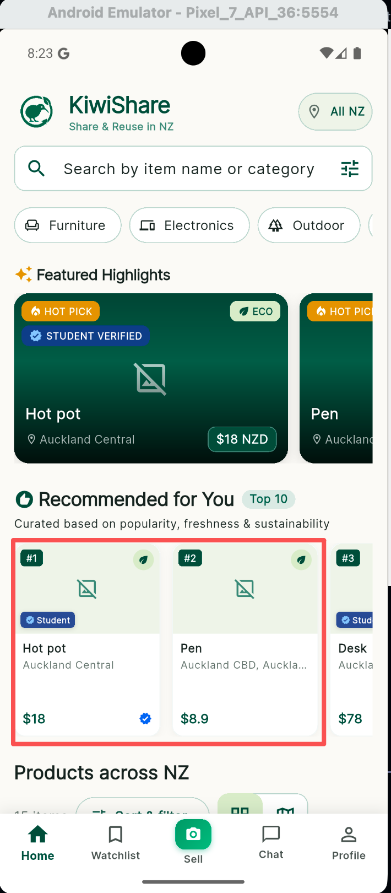
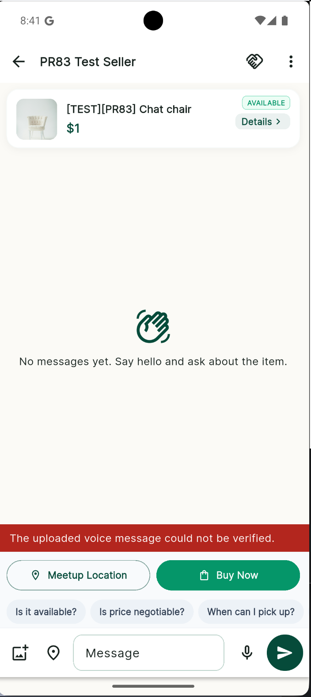
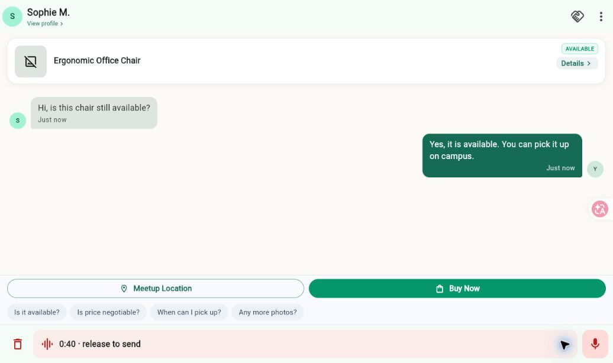
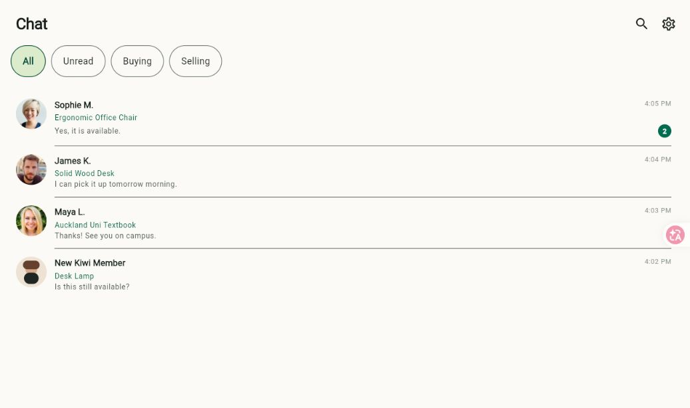

# QA evidence for issues #301 and #302

These screenshots capture the Android emulator failures reported by QA before
the fixes in PR #311.

## Issue #302: listing images

The Home screen rendered placeholders for valid product-image URLs.

## Issue #301: voice-message verification

The chat API rejected a recorded voice message because the deployed server
could not run its FFmpeg verification binary.

## Post-fix voice composer

The screenshot below was captured from the real Flutter web rendering of the
final conversation screen after tapping the microphone. It verifies that the
composer switches to the dedicated recording bar, exposes cancel and send
controls, and keeps the rest of the conversation layout stable.

The same recording state is also protected by the
`captures the voice recording composer for review evidence` regression test.
The local development machine does not have an Android AVD; automated Flutter
and API regression coverage is recorded in the PR description.

## Post-fix chat participant avatars

The Chat list now consumes the `participant.avatarUrl` already returned by the
conversation API and renders each counterpart's profile photo. A styled
fallback remains for users without an avatar or when an image cannot load.

The `renders the participant profile photo in each chat row` widget regression
test verifies that the API model's avatar URL reaches the rendered chat tile.
